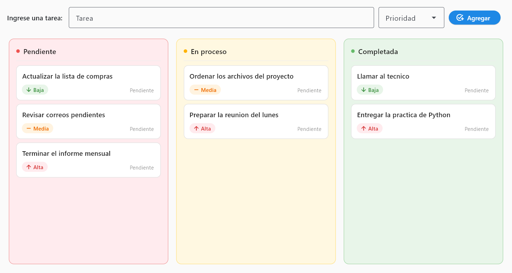

Administrador de tareas

Este es un proyecto personal hecho en Python con Flet. La idea es tener un tablero
sencillo para organizar tareas en tres columnas: Pendiente, En proceso y Completada.

Cada tarea se crea desde la barra de arriba, donde se escribe el nombre y se elige
una prioridad. Despues la tarea se puede arrastrar de una columna a otra y su estado
se actualiza solo. La tarjeta de cada tarea es blanca y la prioridad se marca con un
icono y un color suave en una etiqueta.

Asi se ve la aplicacion con algunas tareas de ejemplo:

Que se puede hacer

- Agregar tareas indicando nombre y prioridad (alta, media o baja)
- Arrastrar tareas entre las tres columnas
- Ver el estado actualizado de cada tarea al moverla
- Distinguir la prioridad por el icono y el color de la etiqueta

Requisitos

Python 3.10 o superior y la libreria Flet.

Como ejecutarlo

Primero crear el entorno virtual e instalarlo:

    python -m venv .venv

En Windows:

    .venv\Scripts\Activate.ps1

En Linux o macOS:

    source .venv/bin/activate

Luego instalar Flet y correr la aplicacion:

    pip install flet
    python src/main.py

Como esta organizado

    src/main.py                 arranca la aplicacion y arma la pagina
    src/components/inputs.py    barra para escribir la tarea y elegir prioridad
    src/components/tarjeta.py   las tres columnas del tablero y el arrastrar y soltar
    src/components/tarea.py     la tarea en si, con su prioridad y su estado

Notas

Las tareas se guardan solo en memoria, asi que al cerrar la aplicacion se pierden.
Todavia no hay base de datos ni archivo para persistirlas.
